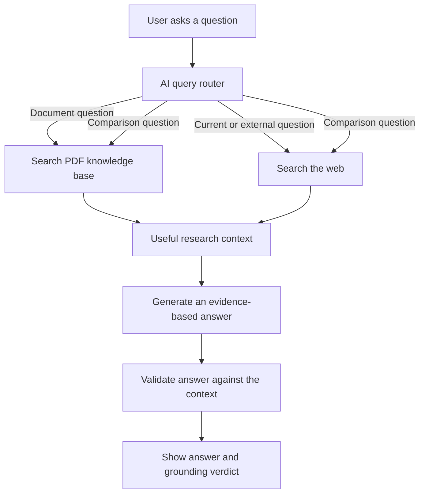

# AI Research Assistant: Ask Your PDF, Then Search the Web

What if you could give an AI assistant a long PDF, ask it questions about that document, and trust it to search the internet only when the answer is not inside the PDF?

That is what this project does.

This is a small but complete **agentic RAG (Retrieval-Augmented Generation) assistant**. You place a document in the `data` folder, update the document path and instructions when needed, and then talk to the assistant from your terminal.

It first checks the knowledge inside your document. If the question is outside that document, it can look for fresh information on the web. After writing an answer, another AI check reviews whether the answer is actually supported by the information that was found.

The `data` folder can contain one or more PDFs. The current project includes research papers such as *Attention Is All You Need*, but it is designed as a starting point for many other use cases:

- Ask questions about a research paper.
- Explore company policies or product documentation.
- Search through a study guide, book, or technical manual.
- Build a private knowledge assistant for a team.
- Compare information in your document with current information from the web.

## Why This Project Is Interesting

Most simple chatbots answer every question from the language model's memory. That can be a problem: the answer may be old, incomplete, or simply made up.

This assistant follows a more thoughtful process:

1. It understands what the user is asking.
2. It decides where the answer should come from.
3. It searches the uploaded document, the web, or both.
4. It gives the useful information to the language model.
5. It checks whether the final answer is grounded in that information.

So the model is not blindly answering everything. It is choosing a source, collecting evidence, answering from that evidence, and then checking its own work.

## The Main Idea

Imagine the assistant has two research desks:

- **Document desk:** searches the PDF that you provide.
- **Web desk:** searches the internet for information that is external, recent, or missing from the PDF.

An AI query router acts like the research manager. It decides whether a question belongs at the document desk, the web desk, or both desks.

For example:

- "What is the main idea of this document?" -> searches the PDF.
- "What does this document say about chapter three?" -> searches the PDF.
- "What is the latest development in this field?" -> searches the web.
- "How does the approach in this document compare with current approaches?" -> searches both.

The exact subject depends on the PDF you put in the project. The architecture stays the same.

## How It Works



### Step 1: Add a document

Put one or more PDFs you want to study inside the `data` folder. For example:

```text
data/attention_is_all_you_need.pdf
```

The assistant automatically finds every `.pdf` file in this folder. You can also update the routing instructions in `query_router.py` so the assistant knows what kind of information is inside your documents.

### Step 2: Turn the PDF into searchable knowledge

The assistant does not send the entire PDF to the language model every time. That would be slow, expensive, and often too large.

Instead, `document_processor.py`:

1. Extracts the text from the PDF using `pypdf`.
2. Splits the text into smaller overlapping pieces.
3. Converts each piece into a numerical embedding using `BAAI/bge-small-en-v1.5`.
4. Saves those embeddings in a Chroma vector database.

When a question is asked, the assistant finds the pieces of the document that are most related to that question. This is what makes it possible to work with long documents.

The generated database is stored in `vector_store/`. It is reused on later runs. If you replace the PDF, delete `vector_store/` once so the assistant can build a fresh index.

### Step 3: Decide where to search

`query_router.py` uses a CrewAI agent with a Groq language model. The router returns one of three decisions:

- `local`: search the document only.
- `web`: search the internet only.
- `both`: search the document and the internet.

The routing prompt is designed for user-provided PDFs. When you add a new type of PDF, update that prompt if you want the router to understand a specific subject or scope.

### Step 4: Gather information

`information_retrieval.py` performs the actual searches:

- Chroma searches the document's vector embeddings.
- Tavily searches the web when web information is needed.

The results are combined into one context for the answer generator.

### Step 5: Generate an answer

`response_generator.py` sends the question and retrieved context to the Groq model. Its prompt tells the model to:

- Use only the supplied context.
- Be honest when the context is not enough.
- Avoid inventing details.
- Mention which source results were used.

You can change this prompt when you want a different assistant personality, answer format, level of detail, or domain-specific behavior.

### Step 6: Check the answer

`validation.py` sends the question, context, and generated answer to another Groq call. This second call acts as a strict fact checker.

It returns:

- `Grounded`: the answer is supported by the retrieved context.
- `Partially Grounded`: some claims are supported, but some are not.
- `Not Grounded`: the answer is mostly unsupported or unrelated.
- `Unknown`: the validator did not follow the expected response format.

This does not make the assistant perfect, but it gives the user an important signal instead of showing an answer with no explanation of where it came from.

## Tools And Models Used

| Tool or model | What it does |
| --- | --- |
| Python | Runs the complete application |
| `pypdf` | Reads text from PDF files |
| LangChain | Connects the document processing and retrieval components |
| `RecursiveCharacterTextSplitter` | Breaks long PDF text into useful chunks |
| `BAAI/bge-small-en-v1.5` | Creates embeddings for document search |
| ChromaDB | Stores and searches document embeddings |
| CrewAI | Runs the AI query-routing agent |
| Groq | Provides the language model for routing, answering, and validation |
| `openai/gpt-oss-120b` | The Groq model used by this project |
| Tavily | Searches the live web |
| `python-dotenv` | Loads API keys from `.env` |

## Project Structure

```text
.
|-- data/                              # Add one or more PDFs here
|   |-- attention_is_all_you_need.pdf
|   `-- other_document.pdf
|-- document_processor.py               # Read, split, embed, and index the PDF
|-- information_retrieval.py            # Search the PDF and the web
|-- query_router.py                     # Choose local, web, or both
|-- response_generator.py               # Write an answer from the context
|-- validation.py                       # Check whether the answer is grounded
|-- main.py                             # Start the demo and terminal assistant
|-- install_dependencies.txt             # Dependency installation command
`-- README.md
```

## Setup

You need Python and API keys for Groq and Tavily. Internet access is also needed to download the embedding model and use the online services.

Create a virtual environment:

```bash
python -m venv .venv
```

Activate it on Windows PowerShell:

```powershell
.\.venv\Scripts\Activate.ps1
```

Install the packages:

```bash
pip install pypdf langchain langchain-core langchain-community langchain-text-splitters langchain-huggingface langchain-chroma langchain-groq langchain-protocol crewai crewai-tools chromadb sentence-transformers groq python-dotenv tavily-python tiktoken pip-system-certs
```

Create a `.env` file in the project root:

```env
GROQ_API_KEY=your_groq_api_key
TAVILY_API_KEY=your_tavily_api_key
```


## Run It

Make sure your PDF path is correct in `document_processor.py`, then run:

```bash
python main.py
```

The first run creates the vector store. It then runs a few example questions and opens an interactive prompt where you can ask your own questions.

Type `exit` or `quit` to close the assistant.

## Make It Your Own Assistant

This project is meant to be adapted. The most important changes are:

1. Put one or more PDFs in `data/`.
2. Update the document description and routing rules in `query_router.py` if needed.
3. Adjust the answer instructions in `response_generator.py` for your preferred style.
4. Delete `vector_store/` and run the project again to index the new PDFs.

For example, you could turn the same code into a legal-document assistant, a study assistant, a product-manual assistant, or a research-paper assistant simply by changing the document and prompts.
